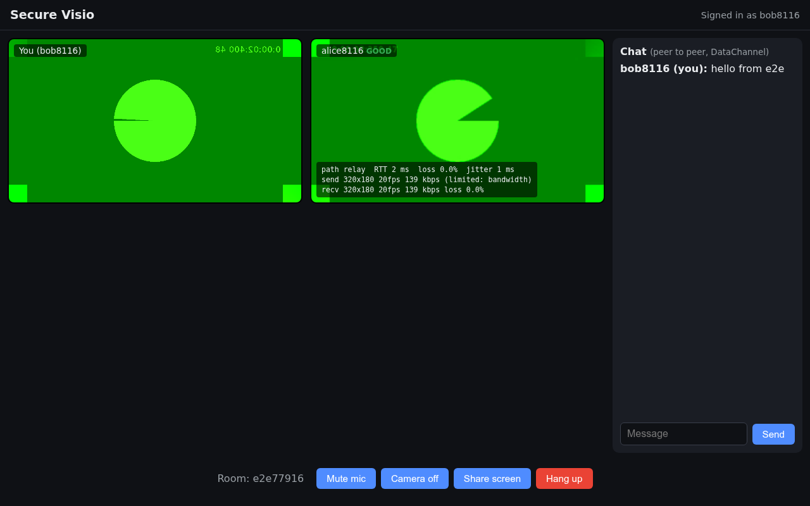

# Secure Visio: secure WebRTC video conferencing over IP

Video conferencing in the browser built on WebRTC, with our own WebSocket
signaling server, RTP/SRTP media transport, authentication and encryption,
live QoS monitoring and automatic congestion detection and adaptation.



## Features

| Area | What is implemented |
|---|---|
| Media | Camera + microphone (`getUserMedia`), echo cancellation, mute, camera off, screen sharing (`replaceTrack`, no renegotiation) |
| Calls | Rooms of up to 6 people, mesh topology (one `RTCPeerConnection` per participant) |
| Signaling | Custom JSON protocol over WebSocket: `auth`, `join`, `leave`, `offer`, `answer`, `ice` |
| NAT traversal | STUN + our own TURN server (coturn) with short-lived HMAC credentials |
| Security | Login with scrypt-hashed passwords, JWT, authenticated WSS, room isolation, input validation, rate limiting, CSP and security headers, DTLS-SRTP media |
| QoS | Per-participant live stats from `getStats()`: RTT, loss, jitter, bitrate, resolution, fps, network path |
| Congestion | 3 levels (good / degraded / congested) with hysteresis; caps bitrate, resolution and framerate per link with `setParameters()` |
| Chat | Peer-to-peer text chat over an `RTCDataChannel` |

## Architecture

```
 Browser A                        Server (Node.js)                    Browser B
 ┌──────────────┐  HTTPS  ┌────────────────────────────┐  HTTPS  ┌──────────────┐
 │ login form   │────────▶│ /api/login  /api/register  │◀────────│              │
 │              │         │ /api/ice (TURN credentials)│         │              │
 │ signaling.js │◀═══════▶│ /ws  signaling (rooms,     │◀═══════▶│ signaling.js │
 │              │   WSS   │     offer/answer/ice relay)│   WSS   │              │
 │ call.js      │         └────────────────────────────┘         │ call.js      │
 │ RTCPeerConn. │◀═══════════ SRTP media + DataChannel ═════════▶│ RTCPeerConn. │
 └──────────────┘    direct (host/srflx) or via coturn (relay)   └──────────────┘
```

The server never sees audio or video: it only relays signaling messages
between authenticated members of the same room.

| File | Role |
|---|---|
| `server.js` | Reads environment config, starts the server |
| `src/app.js` | Express app, security headers, HTTP/HTTPS server |
| `src/auth.js` | Accounts (scrypt), JWT, login rate limiting |
| `src/turn.js` | ICE server list with HMAC TURN credentials |
| `src/signaling.js` | WebSocket rooms and message relay |
| `public/js/main.js` | Page flow and UI |
| `public/js/call.js` | Peer connections, mesh, chat, controls, adaptation |
| `public/js/stats.js` | Reads metrics from `getStats()` |
| `public/js/qos.js` | Congestion classification and controller (pure, unit tested) |

## Run it

Requirements: Node.js 20+, a browser. Docker for TURN.

```bash
npm install
npm start            # http://localhost:3000
```

Open http://localhost:3000 in two browser windows, create two accounts, join
the same room.

### On a LAN (two machines)

Browsers only allow the camera on HTTPS, so generate a certificate first:

```bash
npm run certs        # self-signed cert for localhost + your LAN IP
npm start            # https://<your-ip>:3000, accept the warning once
```

### With TURN (Docker)

```bash
cp .env.example .env # set JWT_SECRET, TURN_SECRET, PUBLIC_IP (LAN IP)
                     # LAN demo: also TURN_ALLOWED_PEER_IP=<PUBLIC_IP>
npm run certs
docker compose up -d --build
```

Tick "Force TURN relay" in the lobby to prove media goes through coturn.

## Tests

```bash
npm test             # unit (QoS logic) + integration (auth, signaling security)
npm run e2e          # 3 headless Chrome users: video, stats, chat, hang up
RELAY=1 TURN_SECRET=... TURN_URLS=turn:<ip>:3478 npm run e2e   # through TURN
npm run congestion   # Docker: adds 15% loss on a TURN container, checks
                     # detection, bitrate cap and recovery
```

Manual network degradation on Linux:

```bash
sudo scripts/netem.sh lo loss 10%
sudo scripts/netem.sh lo delay 300ms 50ms
sudo scripts/netem.sh lo clear
```

## Measured results

From `npm run congestion` (2 users relayed through coturn, 15% loss added):

| Phase | Level | Video sent | Bitrate |
|---|---|---|---|
| Clean network | good | 640x360, 20 fps | 313 kbps |
| 15% packet loss | congested (detected in ~2 s) | 240x135, 15 fps | 89 kbps |
| Loss removed | degraded, then good | 640x360, 20 fps | 322 kbps |

See [ROADMAP.md](ROADMAP.md) for how the project was built step by step.
